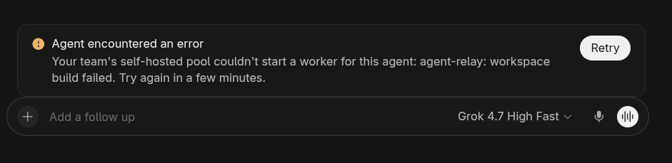

# Q02-build: Cursor workspace build failure

**Result: pass for the intentionally failed QA build.** Only `qa-cursor` used `forced_failure_mode=terraform_build`; the Claude QA pool remained normal. A Cursor request was received and claimed at 15:12:18 UTC. The disposable workspace build began at 15:12:22, failed as injected at 15:12:28, and the Relay sent Cursor a retryable failure notification that Cursor accepted.

The tester's screenshot shows a clear, safe error rather than an indefinitely waiting turn:

> Agent encountered an error
>
> Your team's self-hosted pool couldn't start a worker for this agent: agent-relay: workspace build failed. Try again in a few minutes.

The original screenshot's creation metadata places its capture at **15:12:44 UTC**, within the single scoped-fault request. The displayed message ends with the exact string sent by the Relay. The prompt marker `QA-Q02-BUILD-AC47E887` was instructed but is not visible in the Relay log or screenshot, so its presence in the prompt is not independently verified. The screenshot contains no account details, secret or unrelated conversation content.

**Cleanup:** The Relay queued deletion at 15:12:28 UTC. Coder showed no QA workspaces by 15:12:55. The original config was restored byte-for-byte and the Relay restarted with both pool-health gauges at 1 by 15:13:39; no manual deletion was needed. No other Q02 variant was run.

The public 941×229 PNG preserves the original pixels while removing its text and ancillary metadata. Original SHA-256: `58d55cee6bbed383323e12bb96fb81c1eb01f823d9ecd988e1f6d86d9b245ab4`; public PNG SHA-256: `a9b5238a9675da034042cc34232cbac4c4a1404f3bc55158290a3117d719073e`. The timestamped, sourced event timeline is in `Q02-build.json`. No raw logs, provider IDs or transcript are included.
